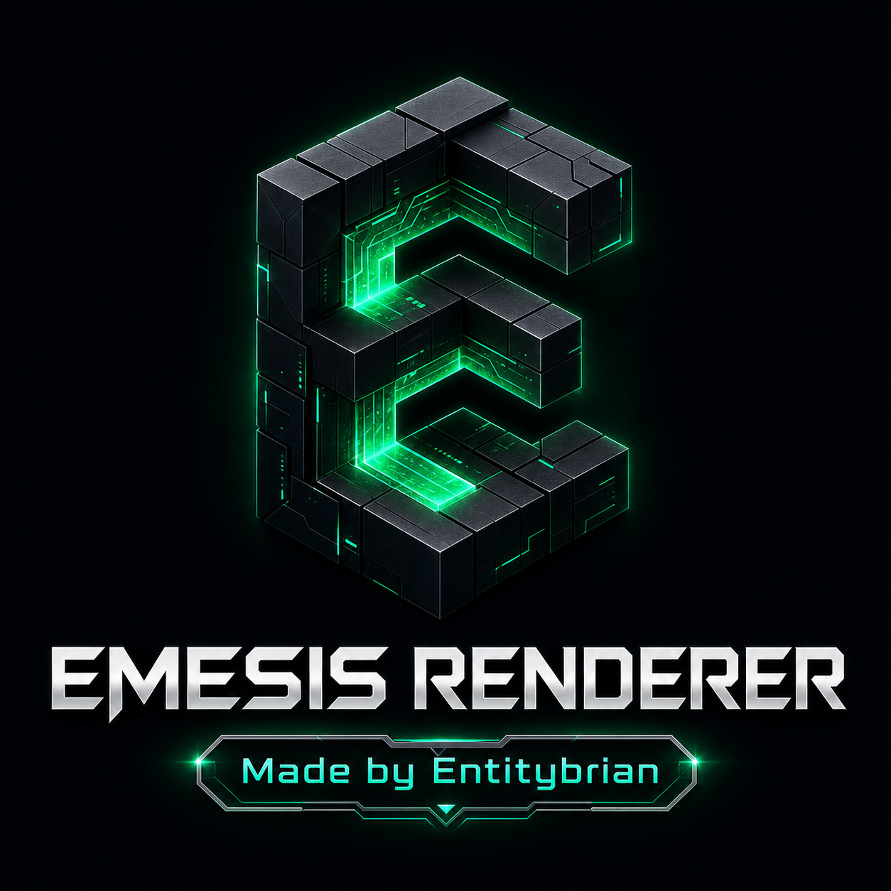

  

  # Emesis Renderer
  ### **Made by Entitybrian**

  **Universal All-in-One Android Renderer Plugin APK for All Pojav Variants & Minecraft: Java Edition**

  

---

## Official Release Download

- **Direct Universal APK Download (32-bit & 64-bit Android):**
  [**`EmesisRenderer-Universal-v1.0.0.apk`**](https://github.com/entitybrian69-bit/Emesis-renderer-/releases/download/v1.0.0/EmesisRenderer-Universal-v1.0.0.apk)
- **GitHub Release Page (`v1.0.0`):**
  [https://github.com/entitybrian69-bit/Emesis-renderer-/releases/tag/v1.0.0](https://github.com/entitybrian69-bit/Emesis-renderer-/releases/tag/v1.0.0)

---

## Overview

**Emesis Renderer** is a universal all-in-one Android launcher renderer plugin APK created by **Entitybrian**, engineered for full compatibility across **all variants of PojavLauncher** and its forks/continuations. It bundles two isolated native OpenGL-over-GLES rendering pipelines behind a single runtime version router (`libemesis_renderer.so`):

| Minecraft Version Range | Active Native Pipeline | Graphics Profile |
| :--- | :--- | :--- |
| **Minecraft `> 1.16.5`** *(1.17 – 1.21.x, 26.x+, snapshots `>= 21w10a`)* | **Emesis Modern Core** (`libemesis_modern.so`) | Desktop OpenGL 3.2 – 4.6 Core Profile over OpenGL ES 3.x (automatic GLES 3.2 / 3.1 / 3.0 context promotion) |
| **Minecraft `<= 1.16.5`** *(Classic, Beta, 1.7.10, 1.8.9, 1.12.2, 1.16.5)* | **Emesis Compatibility Core** (`libemesis_legacy.so`) | Desktop OpenGL 2.1 / 3.x Compatibility + GLSL/SPIR-V Shader Compiler with 32-bit GLES 2.0/3.x fallback |

---

## Universal Device Architecture Support (Including 32-bit Android)

A single **`EmesisRenderer-Universal-v1.0.0.apk`** supports Android 5.0+ (`minSdkVersion 21`) through Android 15/16+ (`targetSdkVersion 34`, 16KB page-aligned ELF segments) across **all four Android ABIs**:

- `armeabi-v7a` — **32-bit ARM** smartphones & tablets
- `arm64-v8a` — **64-bit ARM** smartphones & tablets
- `x86` — **32-bit Intel/AMD** Chromebooks, tablets & Android emulators
- `x86_64` — **64-bit Intel/AMD** Chromebooks, handheld PCs & Android emulators

---

## Compatible Across All Pojav Variants

Emesis Renderer implements **every** renderer integration contract across the Pojav ecosystem in a single APK:

1. **RendererPlugin V2 (`fclPlugin_V2`) — Native Plugin + In-Launcher Settings UI**
   - **ZalithLauncher 2** (`com.movtery.zalithlauncher.v2`)
   - **FoldCraftLauncher (FCL)** & modern V2-enabled forks (`com.tungsten.fcl`, `org.fcl.enchantnet`)
2. **RendererPlugin V1 (`pgwRendererPlugin` / `zalithRendererPlugin` / `fclPlugin`) — Zero-Config Auto Discovery**
   - **Pojav Glow Worm (PGW / PojavZH)** (`com.movtery.pojavzh`)
   - **PojavLauncher Beta / Zink** & **Pojav Firefly / Horizon** (`net.kdt.pojavlaunch.beta`, `net.kdt.pojavlaunch.firefly`)
   - **ZalithLauncher 1** (`com.movtery.zalithlauncher`)
   - **Boat-based Pojav/FCL hybrids** (`boatEnv` + `pojavEnv` + `DLOPEN` + full-path `eglName`)
3. **Vanilla Pojav `custom_env.txt` Native Bridge (Built-In One-Tap Generator in App)**
   - **Official PojavLauncher** (`net.kdt.pojavlaunch`, debug & nightly builds)
   - **Amethyst** (`org.angelauramc.amethyst`)
   - **MojoLauncher** & **SolCraftLauncher** (`git.artdeell.mojo`, `git.artdeell.solcraft`)
   - **QuestCraft** (`com.qcxr.qcxr`)

### Installation & Usage

- **On Plugin-Enabled Pojav Variants (Zalith 1/2, Pojav Glow Worm, Pojav Beta-Zink, Pojav Firefly, FCL):**
  1. Install **`EmesisRenderer-Universal-v1.0.0.apk`**.
  2. Open your launcher's **Renderer Settings** and select **`Emesis Renderer (All Versions — Made by Entitybrian)`**.
  3. Launch any Minecraft version (`<= 1.16.5` or `> 1.16.5`).

- **On Vanilla Official PojavLauncher / Amethyst / MojoLauncher / QuestCraft:**
  1. Install **`EmesisRenderer-Universal-v1.0.0.apk`** and open **Emesis Renderer** from your app drawer.
  2. In the **All Pojav Variants Compatibility** card, tap **Write to Pojav** or **Copy `custom_env`** to apply the pre-filled `custom_env.txt` bridge for your device's exact `nativeLibraryDir` path (keep the launcher's built-in renderer dropdown on default OpenGL ES 2.0).
  3. Launch any Minecraft version (`<= 1.16.5` or `> 1.16.5`) — Emesis Renderer automatically intercepts EGL + LWJGL/SDL OpenGL and routes to the matching native core.
